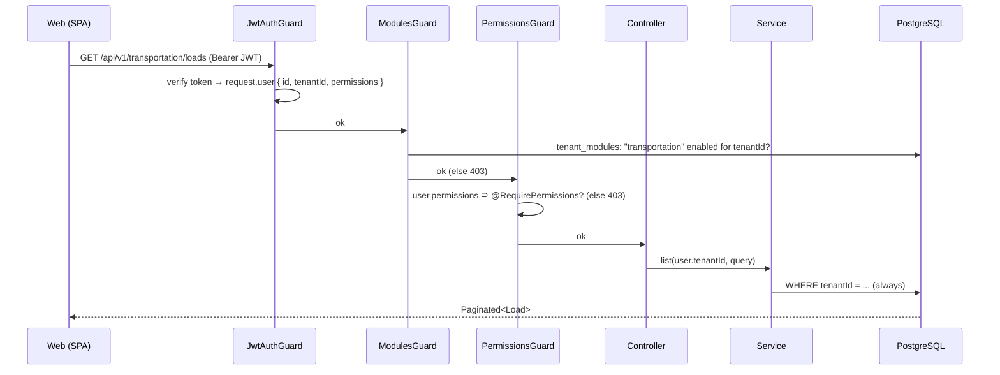

# Architecture

## Monorepo

pnpm workspaces, TypeScript everywhere:

```
apps/
  api/        NestJS — the only process talking to the database
  web/        SvelteKit SPA — talks to the API over REST
packages/
  shared/     Pure TypeScript, no runtime deps. Domain contracts shared front/back:
              status enums, workflow state machines, permission & module catalogs, API types.
  database/   Prisma schema + seed. Re-exports @prisma/client so apps never depend on it directly.
```

Dependency direction (build order): `shared` → `database` → `api` / `web`.
`shared` is the **source of truth** for enums and permission keys; the Prisma schema mirrors enum
values, and the seed writes the catalogs into the database.

## API layering (apps/api)

```
src/
  main.ts              bootstrap: /api/v1 prefix, validation pipe, CORS, Swagger (/api/docs)
  app.module.ts        wires modules + global guards
  prisma/              PrismaService (global)
  common/              decorators, guards, pagination, shared DTOs
  core/                platform modules: auth, tenants, users, roles, permissions,
                       audit-logs, documents, notifications, integrations, module-registry
  modules/
    transportation/    business module: one folder per aggregate
                       (customers, locations, carriers, drivers, vehicles, trailers,
                        rates, transport-orders, shipments, loads, routes, tracking)
```

### Request pipeline



Every request passes three global guards, in order:

1. **JwtAuthGuard** — validates the Bearer token (skipped on `@Public()` endpoints). The JWT
   payload (user id, tenantId, permission keys) becomes `request.user`.
2. **ModulesGuard** — if the controller carries `@RequireModule(key)`, verifies the module is
   enabled for the caller's tenant (`tenant_modules` table). This is what makes modules
   activable per tenant.
3. **PermissionsGuard** — if the handler carries `@RequirePermissions(...)`, verifies the JWT
   permission set contains them all.

Services receive `tenantId` explicitly from controllers (taken from `@CurrentUser()`) and filter
every query with it — see [multi-tenancy.md](./multi-tenancy.md).

### Workflow enforcement

Status transitions for TransportOrder/Shipment/Load are defined once in
`packages/shared/src/workflows` and enforced in services (`canTransition*`). Invalid transitions
return 400. Status changes write an `audit_logs` row and, for execution events, a
`tracking_events` row.

## Web app (apps/web)

- SvelteKit in **SPA mode** (`ssr=false`, adapter-static with `index.html` fallback): JWT lives
  client-side; SSR will be revisited with SSO/session auth.
- `src/lib/api/client.ts` — typed fetch wrapper (Bearer header, 401 → redirect `/login`).
- `src/lib/stores/auth.ts` — session store persisted in localStorage.
- Route group `(app)` carries the authenticated shell (sidebar + guard). Navigation entries are
  conditioned on `tenant.enabledModules`, so a tenant without the TMS sees no TMS menu.
- Dev server proxies `/api` → `http://localhost:3000` (no CORS during development).

## MFA plateforme (phase 7.4)

### Flux d'authentification à étapes

```
POST /platform/auth/login
  ├─ mfaEnabledAt défini   → { mfaRequired: true, mfaToken (scope: mfa-pending, 5 min) }
  │                             └─ POST /platform/auth/mfa/verify { mfaToken, code }
  │                                    → { accessToken, user }
  ├─ PLATFORM_MFA_ENFORCED=true (MFA non enrôlé)
  │                         → { mfaEnrollmentRequired: true, enrollToken (scope: mfa-enroll, 10 min),
  │                              otpauthUrl }
  │                             └─ POST /platform/auth/mfa/enroll { enrollToken, code }
  │                                    → { recoveryCodes[8], accessToken }
  └─ Pas de MFA             → { accessToken, user }

POST /platform/auth/mfa/enroll-start   (authentifié via @PlatformController)
  → { enrollToken, otpauthUrl }        (pour l'enrôlement opt-in après login)
```

### Scopes des step tokens

Les step tokens (`mfa-pending`, `mfa-enroll`) partagent le `JWT_SECRET` mais portent un champ
`scope`. La `PlatformJwtStrategy` rejette tout payload dont `scope` est défini — ces tokens ne
peuvent jamais être utilisés comme access tokens sur les routes `/platform/**`.

Le token `mfa-enroll` contient en plus `secretEnc` (le secret TOTP chiffré `enc:v1`), ce qui
évite de persister un secret non confirmé en base. Aucune trace en base avant que l'utilisateur
ne valide son premier code TOTP.

### Stockage des credentials MFA

| Colonne | Valeur | Remarque |
|---|---|---|
| `totpSecret` | `enc:v1:<chiffré AES-256-GCM>` | Déchiffré à la volée pour vérifier |
| `mfaEnabledAt` | timestamp | `null` = non enrôlé |
| `recoveryCodes` | `bcrypt hash[]` | 8 codes, consommés un à un |

Les codes de récupération ne sont jamais récupérables après la confirmation de l'enrôlement.
Chaque utilisation supprime le code de la liste (`update recoveryCodes = filter(...)`).

### Throttling ciblé

`ThrottlerModule` (NestJS) est configuré dans `AppModule` (20 req/min/IP). Le `ThrottlerGuard`
est appliqué **uniquement** sur `PlatformAuthController` — la porte cross-tenant exposée — et
non sur l'ensemble de l'API (les suites e2e partagent une IP et auraient déclenché des 429).

### Décorateur composite `@PlatformController()`

```typescript
export function PlatformController() {
  return applyDecorators(Public(), UseGuards(PlatformGuard));
}
```

Toutes les routes `/platform/**` (sauf `PlatformAuthController` qui gère sa propre chaîne)
utilisent ce décorateur. L'ancienne paire manuelle `@Public()` + `@UseGuards(PlatformGuard)`
laissait la porte ouverte si l'un des deux était oublié.

## Decisions & trade-offs (v0)

| Decision                          | Rationale / revisit point                                  |
| --------------------------------- | ---------------------------------------------------------- |
| Shared DB, `tenantId` column      | Cheapest to operate; revisit schema-per-tenant on demand    |
| Permissions embedded in JWT       | No per-request DB hit; role changes apply at next login — revisit with refresh tokens |
| ModulesGuard queries DB per req   | Correctness first; cache planned (phase 2)                  |
| Count-based document numbering    | Simple; replace with per-tenant sequences (phase 1)         |
| REST (not GraphQL)                | Predictable, cacheable, easy to integrate for B2B customers |
| SPA (not SSR)                     | JWT-only auth; flip when sessions/SSO arrive                |
