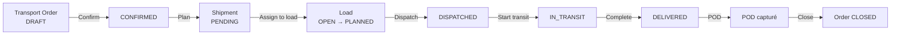
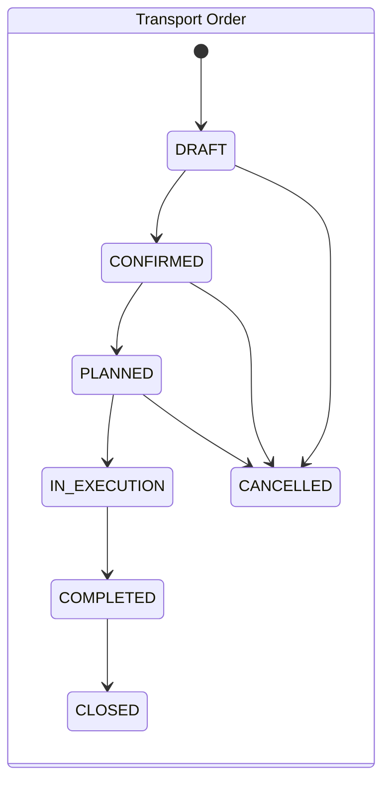
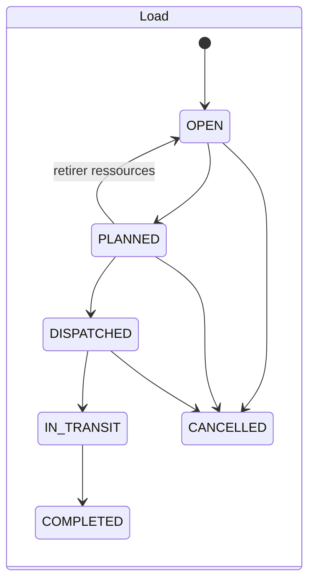

# Guide fonctionnel — Pulsar TMS

> Document orienté métier et utilisateur. Pour le fonctionnement interne, voir
> [architecture.md](./architecture.md) et [data-model.md](./data-model.md) (en anglais).

## 1. À quoi sert Pulsar ?

Pulsar est une plateforme logistique pour **manufacturiers et distributeurs** qui expédient depuis
leurs usines/entrepôts vers les sites de leurs clients. Le premier module, **Transportation
(TMS)**, couvre le cycle complet d'une expédition :

> **Un client demande un transport → on planifie → on choisit un transporteur → on expédie →
> on suit → on prouve la livraison → on ferme le dossier.**

La plateforme est **multi-organisation** (chaque entreprise cliente = un *tenant*, totalement
isolé des autres) et **modulaire** (chaque tenant n'active que les modules auxquels il a
souscrit ; les futurs modules : Flotte, Cour, WMS léger, Portail client, Analytique, Facturation).

## 2. Les concepts, en langage clair

| Terme dans l'écran | C'est quoi concrètement                                                       |
| ------------------- | ----------------------------------------------------------------------------- |
| **Transport Order** | La demande commerciale : « livrer 22 palettes de l'usine X au DC Y pour jeudi ». C'est le dossier que suit le service à la clientèle. |
| **Shipment**        | L'unité de fret à déplacer, dérivée de l'ordre lors de la planification. C'est l'objet que les planificateurs manipulent. (Aujourd'hui : 1 ordre = 1 shipment ; le découpage en plusieurs shipments viendra.) |
| **Load**            | Le voyage physique d'un camion. On y regroupe un ou plusieurs shipments et on y affecte transporteur, chauffeur, tracteur, remorque et tarif. |
| **Route / Stop**    | L'itinéraire du load : la séquence ordonnée d'arrêts (cueillettes puis livraisons), avec heures prévues et réelles. |
| **Customer**        | Le client donneur d'ordre (celui qui demande le transport).                   |
| **Location**        | Un lieu physique : usine, entrepôt, centre de distribution, site client…      |
| **Carrier**         | Le transporteur (codes SCAC/MC/DOT, contacts).                               |
| **Driver / Vehicle / Trailer** | Les ressources d'exécution. Un chauffeur sans transporteur = flotte interne. |
| **Rate**            | Une entente tarifaire (forfait, au km, au 100 lb, à la palette, spot), côté achat (transporteur) ou vente (client). |
| **Tracking Event**  | Un événement de suivi horodaté : réparti, arrivé à l'arrêt, en retard, livré… |
| **POD** (Proof of Delivery) | La preuve de livraison : qui a signé, quand, remarques. Une seule par shipment. |

## 3. Qui fait quoi (rôles types)

Les rôles sont configurables par tenant (catalogue de permissions), mais le découpage visé :

| Persona                | Ce qu'il fait dans Pulsar                                  | Permissions clés |
| ---------------------- | ----------------------------------------------------------- | ---------------- |
| **Service clientèle**  | Crée et confirme les transport orders, suit l'avancement    | `orders.*`       |
| **Planificateur**      | Transforme les ordres en shipments, monte les loads, choisit le transporteur, construit les routes | `planning.*` |
| **Répartiteur (dispatch)** | Lance l'exécution : dispatch, transit, arrivées/départs aux arrêts, livraison | `execution.manage`, `tracking.*` |
| **Resp. données / tarifs** | Gère clients, lieux, transporteurs, flotte, tarifs       | `master-data.*`, `rates.*` |
| **Administrateur**     | Gère utilisateurs, rôles, modules actifs, consulte l'audit  | `core.*`         |

Compte de démonstration : `admin@pulsar.dev` / `admin123` (tenant `acme`) — possède tout.

## 4. Le cycle de vie, étape par étape

### Étape 1 — Saisir la demande (Service clientèle)

**Écran : Transport Orders → New order.**
Choisir le client, l'origine, la destination, les dates souhaitées, poids/palettes, référence
client (n° de PO). L'ordre est créé en **DRAFT** avec un numéro automatique `TO-000123`.

- Un ordre DRAFT est encore modifiable ; dès qu'il est confirmé, il ne l'est plus.
- **Confirm** = engagement : la demande est ferme. **Cancel** reste possible jusqu'au dispatch.

### Étape 2 — Planifier (Planificateur)

Sur l'ordre confirmé, **Plan** crée automatiquement le **shipment** (statut PENDING) avec les
caractéristiques de l'ordre. L'ordre passe à **PLANNED**.

**Écran : Shipments.** Les shipments PENDING forment le « bassin de planification ».
**Assign to load** : choisir un load existant (OPEN/PLANNED) ou en créer un à la volée.
Le shipment passe à PLANNED ; tant que le load n'est pas réparti, **Remove from load** le
renvoie au bassin.

### Étape 3 — Monter le voyage (Planificateur)

**Écran : Loads → détail du load.**

1. **Resources** : affecter transporteur, chauffeur, véhicule, remorque, tarif. Dès la première
   affectation, le load passe d'OPEN à PLANNED.
2. **Route** : « Generate route from shipments » construit l'itinéraire (cueillettes puis
   livraisons). *(v1 : réordonnancement manuel à venir.)*

### Étape 4 — Exécuter (Répartiteur)

Toujours sur le détail du load :

- **Dispatch** — exige un transporteur ou un chauffeur et au moins un shipment. Le load et ses
  shipments passent à DISPATCHED ; les ordres concernés passent à **IN_EXECUTION** ; un événement
  de tracking est créé.
- **Start transit** — le camion roule ; heure de cueillette réelle estampillée.
- À chaque arrêt : **Arrive** puis **Depart** — horodatage réel + événements
  `ARRIVED_AT_STOP` / `DEPARTED_STOP` visibles dans la timeline.
- **Complete (delivered)** — les shipments passent à DELIVERED avec l'heure réelle ; un ordre dont
  tous les shipments sont livrés passe automatiquement à **COMPLETED**.
- **Cancel** (avant le transit) : les shipments retournent au bassin de planification.

### Étape 5 — Prouver et fermer

- **Capture POD** (détail du load, par shipment livré) : nom du signataire, remarques. Une seule
  preuve par shipment — une deuxième tentative est refusée.
- Sur l'ordre **COMPLETED**, **Close** ferme le dossier (statut terminal).

## 5. Règles de gestion à connaître

1. **Aucun saut d'étape** : les statuts suivent des machines d'états strictes. Exemple : on ne
   répartit pas un load OPEN (il faut d'abord des ressources), on ne ferme pas un ordre DRAFT.
   Toute transition invalide est refusée avec un message explicite.
2. **Annulation** : possible pour un ordre jusqu'à la planification incluse, pour un load jusqu'au
   dispatch inclus ; impossible une fois en transit (état CANCELLED = terminal).
3. **Numérotation** : `TO-`, `SH-`, `LD-` + 6 chiffres, séquence propre à chaque tenant, sans trou
   ni doublon même en saisie simultanée.
4. **Traçabilité** : chaque création et chaque changement de statut est journalisé (qui, quand,
   avant/après) dans l'audit ; les événements opérationnels alimentent la timeline de tracking.
5. **Isolation** : un utilisateur ne voit et ne référence que les données de son organisation.
   Référencer un enregistrement d'un autre tenant est impossible (refusé à l'écriture).
6. **Modules** : si le module Transportation est désactivé pour le tenant (Administration →
   Modules), ses écrans disparaissent de la navigation et ses API renvoient un refus explicite.
7. **Permissions** : chaque action de l'écran correspond à une permission précise ; un changement
   de rôle prend effet à la prochaine connexion de l'utilisateur.

## 6. Statuts — aide-mémoire

| Objet     | Statuts (ordre nominal)                                                    |
| --------- | --------------------------------------------------------------------------- |
| Order     | DRAFT → CONFIRMED → PLANNED → IN_EXECUTION → COMPLETED → CLOSED (+ CANCELLED) |
| Shipment  | PENDING → PLANNED → DISPATCHED → IN_TRANSIT → DELIVERED → CLOSED (+ CANCELLED) |
| Load      | OPEN → PLANNED → DISPATCHED → IN_TRANSIT → COMPLETED (+ CANCELLED)          |
| Stop      | PENDING → ARRIVED → DEPARTED / COMPLETED (+ SKIPPED)                        |

## 7. Préparer un nouveau dossier : checklist des données de base

Avant de créer le premier ordre d'un client, vérifier que ces données existent :

1. Le **Customer** (code unique, contact) — écran Customers.
2. Les **Locations** d'origine et de destination (adresses complètes) — via l'API/Swagger pour
   l'instant, écran dédié à venir.
3. Au moins un **Carrier** actif — écran Carriers.
4. Optionnel : chauffeurs, véhicules, remorques, tarifs (pour l'affectation des ressources).

## 8. Limites actuelles (transparence)

- 1 ordre = 1 shipment (pas encore de découpage multi-shipment ni de consolidation multi-clients
  sophistiquée — on peut toutefois mettre plusieurs shipments dans un même load).
- Route générée automatiquement (cueillettes puis livraisons) : pas encore de réordonnancement
  manuel ni d'heures planifiées par arrêt dans l'écran.
- Pas encore : pièces jointes (fichiers réels), notifications courriel, portail client, facturation.
- Le tarif affecté au load est informatif : pas encore de calcul de coût automatique.

La feuille de route détaillée : [ROADMAP.md](../ROADMAP.md).
